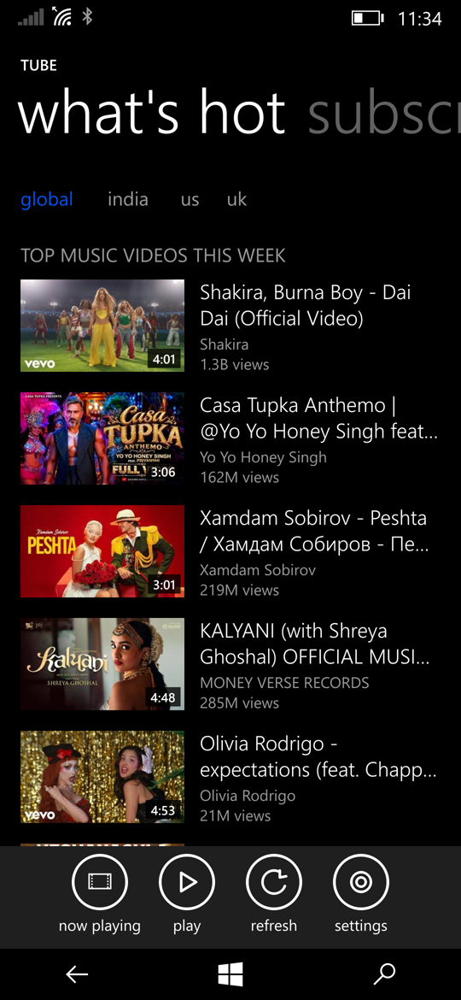

# Tube

YouTube without an account or ads, for [ztOS](https://github.com/madesh-ops/ztOS),
the Windows Phone 8.1-style Linux phone OS. NewPipe's idea, in the phone's own
Metro design.



## What it does

- **what's hot**: YouTube's weekly music charts (global, India, US, UK)
- **subscriptions**: the newest videos from channels you follow, kept on the
  phone, no Google account
- **search**, **history** and **downloads**, side by side in a pivot
- plays in the app, in the background, or from a download
- up to 1080p60, H.264 or VP9 (decoded in hardware on the Galaxy M20's codec),
  AAC or Opus sound; never AV1

## How it works

YouTube is read by [yt-dlp](https://github.com/yt-dlp/yt-dlp) in a process of
its own (`worker.py`, `client.py`), so the UI never waits on it. Playback is
libmpv drawing into a GL surface (`player.py`). Pages and lists come from the
ztOS SDK's `ztos` module (PySide6).

| file | |
|---|---|
| `main.py` | the app: pivot, what's hot, subscriptions, search, history |
| `pages.py` | the video, channel and settings pages |
| `player.py` | mpv playback and its GL surface |
| `widgets.py` | video and channel rows, thumbnails |
| `worker.py`, `client.py` | yt-dlp in a separate process, and the app's side of it |
| `library.py`, `downloads.py` | subscriptions, history, downloads |

## Install

You need a phone running ztOS and the ztOS SDK (`sdk/bin/ztos-sdk` in the
[ztOS repository](https://github.com/madesh-ops/ztOS)). On the phone:

```
pacman -S --needed mpv python-mpv nodejs ffmpeg
```

Then, in this folder on the laptop:

```
ztos-sdk deploy             # build, install on the phone, open it
ztos-sdk logs -f            # what it prints
```

The phone address is `[device] host` in `ztos.toml` (`ztos@172.16.42.1`, USB
networking); override it with `--device user@host`.

## License

GPL-3.0, like ztOS.
